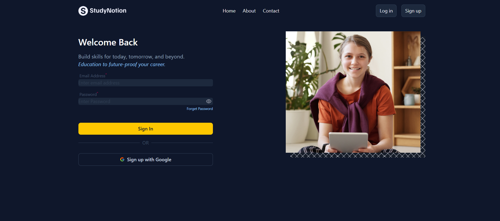
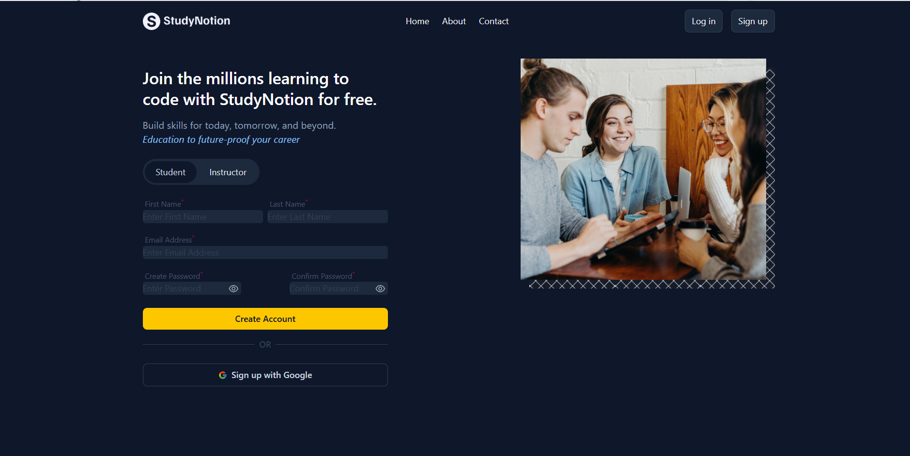

# 🎓 StudyNotion Authentication UI

A modern and responsive **Authentication UI** inspired by **StudyNotion**, built using **React**, **React Router DOM**, and **Tailwind CSS**.

This project focuses on creating a clean and user-friendly authentication interface with seamless navigation between pages. It demonstrates reusable React components, client-side routing, responsive design, and modern frontend development practices.

---

## 🚀 Live Demo

🔗 **Live Website:** https://studynotion-auth-ui.vercel.app/

---

## 📸 Screenshots

### 🏠 Home Page


### 🔐 Login Page



### 📝 Signup Page



---

## ✨ Features

- 🎨 Modern and clean UI
- 🔐 Login Page
- 📝 Signup Page
- 🏠 Home Page
- 🧭 React Router Navigation
- 🔒 Protected Route Implementation
- 📱 Fully Responsive Design
- ♻️ Reusable React Components
- ⚡ Fast Development with Vite

---

## 🛠 Tech Stack

| Technology | Usage |
|------------|-------|
| React | Frontend Library |
| React Router DOM | Client-side Routing |
| Tailwind CSS | Styling |
| JavaScript (ES6+) | Programming Language |
| HTML5 | Markup |
| CSS3 | Additional Styling |
| Vite | Build Tool |

---

## 📂 Project Structure

```
studynotion-auth-ui
│
├── public/
│
├── screenshots/
│   ├── home.png
│   ├── login.png
│   └── signup.png
│
├── src/
│   ├── assets/
│   ├── components/
│   ├── pages/
│   ├── App.jsx
│   ├── App.css
│   ├── index.css
│   └── main.jsx
│
├── package.json
├── vite.config.js
└── README.md
```

---

## ⚙️ Installation & Setup

Clone the repository:

```bash
git clone https://github.com/Arsh173/studynotion-auth-ui.git
```

Go to the project directory:

```bash
cd studynotion-auth-ui
```

Install dependencies:

```bash
npm install
```

Start the development server:

```bash
npm run dev
```

---

## 📚 What I Learned

While building this project, I practiced:

- React Component Architecture
- React Router DOM
- Protected Routes
- Tailwind CSS
- Responsive UI Development
- Reusable Component Design
- Clean Folder Structure
- Frontend Project Organization

---

## 🔮 Future Improvements

- Backend Authentication Integration
- JWT Authentication
- Email Verification
- Forgot Password Functionality
- Form Validation using React Hook Form
- API Integration
- User Profile Management

---

## 🤝 Contributing

Contributions, suggestions, and feedback are always welcome.

If you'd like to improve this project, feel free to fork the repository and create a pull request.

---

## 👨‍💻 Author

**Arsh**

- GitHub: https://github.com/Arsh173

---

## ⭐ Show Your Support

If you liked this project, consider giving it a ⭐ on GitHub.

It helps and motivates me to build more projects.